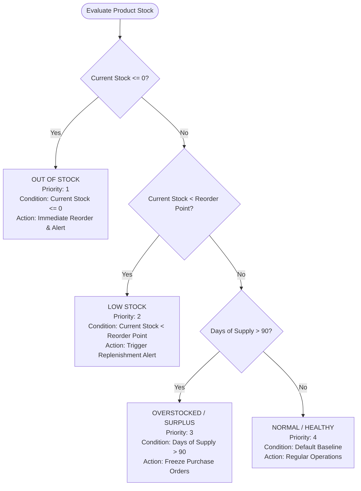
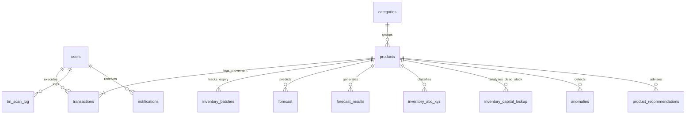

# 🧠 IntelliWare IMS: Comprehensive Master Cheat Sheet & Technical Architecture Guide
> **IntelliWare: A Data-Driven Inventory Management System Using Data Analytics and Rule-Based Classification for Decision Support for Shea and Nicole’s General Merchandise Store**  
> *Developed for College of Computer Studies, Pamantasan ng Lungsod ng Pasig (BSIT Capstone Research)*

---

## 📑 Table of Contents
1. [Executive System Overview](#1-executive-system-overview)
2. [End-to-End System Architecture & How IntelliWare Works](#2-end-to-end-system-architecture--how-intelliware-works)
3. [Data Analytics Engine: Metrics, Formulas & Visualizations](#3-data-analytics-engine-metrics-formulas--visualizations)
4. [Rule-Based Classification Engine: Logic & Thresholds](#4-rule-based-classification-engine-logic--thresholds)
5. [Machine Learning Demand Forecasting & Algorithm Discussion](#5-machine-learning-demand-forecasting--algorithm-discussion)
6. [Why and How is IntelliWare "Intelligent"?](#6-why-and-how-is-intelliware-intelligent)
7. [System Logic, Workflows & Concurrency Control](#7-system-logic-workflows--concurrency-control)
8. [Database Architecture & Data Model (28 Tables Deep Dive)](#8-database-architecture--data-model-28-tables-deep-dive)
9. [Role-Based Access Control (RBAC) & Security Architecture](#9-role-based-access-control-rbac--security-architecture)
10. [Ultimate Quick Reference Cheat Sheet Table](#10-ultimate-quick-reference-cheat-sheet-table)

---

## 1. Executive System Overview

### The Core Problem Solved
Small and medium retail enterprises (SMEs) like **Shea and Nicole’s General Merchandise Store** traditionally suffer from:
- **Blind Restocking:** Relying on gut feeling rather than demand velocity, leading to capital lockup in slow-moving goods and frequent stockouts of fast-moving items.
- **Product Expiry Wastage:** Inability to track batches and expiry dates, leading to spoilage on the shelves.
- **Tedious Manual Data Entry:** Typing product details, SKUs, and categories manually, introducing human error.
- **Decoupled Local Market Context:** Ignoring Philippine retail dynamics (payday cutoff spikes on the 15th/30th, typhoon/rainy season panic buying, Ber-month holiday rush).

### What is IntelliWare?
**IntelliWare** is an **Inventory Management System (IMS)** combining:
1. **Deterministic Rule-Based Systems** for real-time operational safety (stock thresholds, FEFO batch allocation, warehouse slotting).
2. **Empirical Data Analytics** for historical performance quantification (sales velocity, days of supply, turnover, ABC-XYZ analysis).
3. **Machine Learning Time-Series Forecasting** (Prophet, XGBoost, LightGBM, Random Forest) for multi-horizon demand projection.
4. **Multimodal Generative AI (Google Gemini)** for zero-shot retail packaging visual OCR and real-time Philippine consumer intent intelligence.
5. **Multi-Channel Alert Dispatch** (In-app badges, PHPMailer SMTP email, and Semaphore SMS) to notify managers before crises occur.

---

## 2. End-to-End System Architecture & How IntelliWare Works

### 2.1 The 3-Tier Architectural Hierarchy
```
┌─────────────────────────────────────────────────────────────────────────┐
│                           PRESENTATION LAYER                            │
│  - Responsive Desktop Web & Mobile Viewport (Bootstrap 5, Vanilla CSS)   │
│  - Real-Time Interactive Dashboards (Chart.js, FontAwesome)             │
│  - Device Camera Capture (Gemini Packaging OCR & Teachable Machine)    │
└────────────────────────────────────┬────────────────────────────────────┘
                                     │ HTTP / JSON API / WebSocket
┌────────────────────────────────────▼────────────────────────────────────┐
│                    APPLICATION & BUSINESS LOGIC LAYER                   │
│  ┌───────────────────────────────┐   ┌───────────────────────────────┐  │
│  │   PHP 8.2 Operational Core    │   │      Python 3.10+ ML Engine   │  │
│  │  - StockMovementService       │   │  - Meta Prophet               │  │
│  │  - LocationCategoryService    │   │  - XGBoost & LightGBM         │  │
│  │  - PhilippineSeasonalService  │   │  - Scikit-Learn Tri-Ensemble  │  │
│  │  - NotificationService        │   │  - TSB Intermittent Demand    │  │
│  └──────────────┬────────────────┘   └───────────────▲───────────────┘  │
│                 │                                    │                  │
│                 ▼                                    │                  │
│  ┌───────────────────────────────┐                   │                  │
│  │      External AI & APIs       │                   │                  │
│  │  - Google Gemini 3.8/3.5 Vis. │                   │                  │
│  │  - Semaphore SMS Gateway      │                   │                  │
│  │  - PHPMailer SMTP Engine      │                   │                  │
│  └───────────────────────────────┘                   │                  │
└────────────────────────────────────┬─────────────────┴──────────────────┘
                                     │ PDO / MySQLi / SQLAlchemy
┌────────────────────────────────────▼────────────────────────────────────┐
│                               DATA LAYER                                │
│  - MariaDB / MySQL 10.4+ (InnoDB Engine, utf8mb4, Relational FKs)       │
│  - 28 Optimized Relational Tables & Covered Indexes                     │
│  - Serialized Model Weights (.joblib) & Audit Export JSONs              │
└─────────────────────────────────────────────────────────────────────────┘
```

### 2.2 Data Flow & System Lifecycle
```
[User Action: Receive / Stock In] ──► Camera Capture / Gemini Vision OCR
                                             │ Auto-extracts metadata
                                             ▼
                                  [StockMovementService]
                                  - Atomically updates `products`
                                  - Inserts `inventory_batches` (FEFO)
                                  - Records `transactions` audit trail
                                             │
      ┌──────────────────────────────────────┴──────────────────────────────────────┐
      ▼                                                                             ▼
[Analytical Engine]                                                       [Rule Engine (IF-THEN)]
- Daily Sales Velocity (DSV)                                              - Check Stock Status:
- Days of Supply (DOS)                                                      * Stock <= 0 -> OUT OF STOCK
- Movement Tier (Fast/Med/Slow)                                             * Stock < Reorder -> LOW STOCK
- Expiry Risk & Sell-Through                                                * DOS > 90 -> OVERSTOCK
      │                                                                     * Expiry <= 30d -> HIGH RISK
      ▼                                                                             │
[Python ML Pipeline]                                                                ▼
- Runs off-peak or on-demand                                              [Notification Dispatch]
- Feature extraction (lags, Fourier, paydays)                             - In-App Notification Bell
- Model training & multi-horizon forecast                                 - SMTP Email (PHPMailer)
- Writes to `forecast_results` & `forecast_metrics`                       - SMS Alert (Semaphore API)
      │                                                                             │
      └──────────────────────────────────────┬──────────────────────────────────────┘
                                             ▼
                               [Live Insights Dashboard]
                               (Visual decision support)
```

---

## 3. Data Analytics Engine: Metrics, Formulas & Visualizations

The Data Analytics Engine is implemented in **PHP 8.2** running on Apache/XAMPP, executing optimized SQL queries over the `transactions` and `inventory_batches` tables.

### 3.1 Mathematical Formulations

#### 1. Monthly Sales Volume ($S_{30}$)
The aggregate quantity of an item sold via outgoing transactions (`stock_out`) over the trailing 30-day window:
$$S_{30} = \sum_{t \in T_{\text{out}}, \text{date} \ge (\text{now} - 30\text{d})} \text{Quantity}_t$$

#### 2. Daily Sales Velocity ($V_{\text{daily}}$)
The average rate of stock depletion per calendar day:
$$V_{\text{daily}} = \frac{S_{30}}{30}$$

#### 3. Days of Supply ($\text{DOS}$) / Stock Runway
Measures how long on-hand inventory will last before stockout, assuming consumption remains constant:
$$\text{DOS} = \begin{cases} 
\frac{\text{Current Stock}}{V_{\text{daily}}} & \text{if } V_{\text{daily}} > 0 \\
999.0 & \text{if } V_{\text{daily}} = 0 \text{ and Current Stock} > 0 \text{ (Dormant Stock)} \\
0.0 & \text{if } V_{\text{daily}} = 0 \text{ and Current Stock} = 0 \text{ (Depleted)}
\end{cases}$$

#### 4. Expiry Sell-Through Runout Days
Calculates whether a batch will sell out before it expires:
$$\text{Sell-Through Days} = \frac{\text{Batch Quantity}}{V_{\text{daily}}}$$
$$\text{Days Until Expiry} = \text{DATEDIFF}(\text{Expiry Date}, \text{Current Date})$$
* **Safe:** $\text{Sell-Through Days} \le \text{Days Until Expiry}$ (Stock will naturally deplete before spoiling).
* **Spoilage Hazard:** $\text{Sell-Through Days} > \text{Days Until Expiry}$ (Items will reach expiration before sales clear them).

### 3.2 Analytics Dashboard Modules
1. **Product Movement Analysis:** Dynamic table displaying on-hand stock, monthly sales, daily velocity, days of supply, movement tier, and stock status.
2. **Category Performance Matrix:** Aggregates stock count, stock value, average items per category, low-stock frequency, and sales contribution percentage.
3. **Sales Trends:** Tracks 30-day chronological volume, unique items sold daily, and average basket size per transaction.
4. **Supplier Performance:** Evaluates vendor product counts, sales velocity, and stockout incidence to assist vendor negotiations.
5. **ABC-XYZ Inventory Matrix (`inventory_abc_xyz`):**
   - **ABC Classification (Revenue Pareto):**
     - Class A: Top 80% of cumulative sales revenue (Critical focus).
     - Class B: Next 15% of cumulative sales revenue.
     - Class C: Bottom 5% of cumulative revenue (Bulk low-value items).
   - **XYZ Classification (Demand Predictability / Coefficient of Variation):**
     - $CV = \frac{\sigma}{\mu}$ (Standard deviation divided by mean demand).
     - Class X ($CV < 0.5$): Steady, constant demand; easy to forecast.
     - Class Y ($0.5 \le CV \le 1.0$): Variable, seasonal demand; requires buffer.
     - Class Z ($CV > 1.0$): Erratic, sporadic demand; high forecast uncertainty.
6. **Capital Lockup & Dead Stock Tracking (`inventory_capital_lockup`):**
   - Calculates frozen capital: $\text{Locked Capital} = \text{Idle Quantity} \times \text{Unit Price}$.
   - Tiers inactivity: **Active**, **Slow**, **Dormant (30d)**, **Dead (60d)**, and **Critical (90d+)**.

---

## 4. Rule-Based Classification Engine: Logic & Thresholds

The Rule-Based Engine applies deterministic expert rules sequentially to guarantee safe store operations.

### 4.1 Stock Status Classification Logic


### 4.2 Real-Time Alert State Crossing & Anti-Spam Cooldown Logic
Implemented in [`NotificationService::evaluateThresholdCrossing`](file:///c:/xampp/htdocs/IntelliWare/src/services/NotificationService.php):
Alerts are **state-transition driven** rather than static polling, preventing notification floods:

```
[Previous Stock] ──────────► [Transaction Occurs] ──────────► [New Stock]
       │                                                            │
       ├─ If Previous > 0 AND New == 0 ────────────────────────────► Trigger OUT_OF_STOCK
       │
       ├─ If Previous > Reorder AND New <= Reorder AND New > 0 ───► Trigger LOW_STOCK
       │
       └─ If Previous <= Reorder AND New < Previous ──────────────► SUPPRESS (No boundary crossing)
```

#### Exact Implementation Code:
```php
public static function evaluateThresholdCrossing(int $previousStock, int $newStock, int $reorderPoint): ?string
{
    // 1. Most urgent: reached 0 from positive stock
    if ($previousStock > 0 && $newStock === 0) {
        return 'OUT_OF_STOCK';
    }

    // 2. Crossed to or below reorder point (and still > 0)
    if ($previousStock > $reorderPoint && $newStock <= $reorderPoint && $newStock > 0) {
        return 'LOW_STOCK';
    }

    // 3. Stock replenish or already sub-threshold movement
    return null;
}
```

#### Cooldown & Deduplication Thresholds:
- **Default Cooldown Window:** `24 Hours` (`notif_cooldown_hours`, configurable in `system_settings`).
- **Urgency Escalation Bypass:** If a product received a `LOW_STOCK` alert within 24 hours, but subsequently reaches `0` (`OUT_OF_STOCK`), the cooldown check allows exactly **one** `OUT_OF_STOCK` alert to break through because stockout is a critical emergency.
- **Index Optimization:** Database queries utilize `idx_notif_cooldown (product_id, channel, status, created_at)` for $O(1)$ fast lookups.

### 4.3 Movement Class Rules (30-Day Velocity Discretization)
Evaluated dynamically from 30-day outgoing transactions ($S_{30} = \sum \text{stock\_out}$):
| Movement Tier | Exact Threshold Inequality | Operational Definition | Store Inventory Policy |
|---|:---:|---|---|
| **Fast-Moving** | $S_{30} \ge 50\text{ units}$ | High inventory turnover ($\ge 1.67\text{ units/day}$) | Tight bi-weekly replenishment; prominent shelf placement |
| **Medium-Moving** | $10 \le S_{30} < 50\text{ units}$ | Steady, predictable baseline turnover | Standard monthly purchasing orders |
| **Slow-Moving** | $1 \le S_{30} < 10\text{ units}$ | Sluggish turnover; risk of inventory aging | Limit purchase batches; review customer appeal |
| **Non-Moving** | $S_{30} = 0\text{ units}$ | Zero recorded sales over the past 30 days | Clearance discounting (30-50%), product bundling, or vendor return |

### 4.4 Expiry Risk Classification Rules & Thresholds
Evaluated from batch-level tracking in `inventory_batches`:
$$\text{Days Until Expiry} = \text{DATEDIFF}(\text{batch.expiry\_date}, \text{CURDATE}())$$
$$\text{Sell-Through Days} = \frac{\text{batch.quantity}}{\text{Daily Sales Velocity}}$$

| Expiry Tier | Exact Threshold Inequality | Risk Level | Prescriptive Store Decision |
|---|:---:|:---:|---|
| **Critical / High Risk** | $\text{Days Until Expiry} \le 30\text{ days}$ | 🔴 High Risk | 30%–50% flash discount; place in front clearance baskets; stop restock |
| **Medium Risk** | $30 < \text{Days Until Expiry} \le 90\text{ days}$ | 🟡 Medium Risk | Bundle with high-velocity items; restrict new purchase orders |
| **Low Risk** | $\text{Days Until Expiry} > 90\text{ days}$ | 🟢 Low Risk | Safe stock rotation; standard FEFO dispatch |
| **Spoilage Hazard** | $\text{Sell-Through Days} > \text{Days Until Expiry}$ | ⚠️ Runout Risk | On-hand quantity will not deplete naturally before expiration |

### 4.5 ABC-XYZ Revenue & Volatility Matrix Thresholds
Computed and stored in [`inventory_abc_xyz`](file:///c:/xampp/htdocs/IntelliWare/database/warehouse_system.sql):

#### 1. ABC Classification (Pareto Revenue Contribution):
- **Class A (Vital Few):** Top `0.00% to 80.00%` of cumulative store revenue. Requires daily monitoring and safety buffer.
- **Class B (Moderate):** Next `80.01% to 95.00%` of cumulative revenue. Standard automated replenishment.
- **Class C (Trivial Many):** Bottom `95.01% to 100.00%` of cumulative revenue. Low capital risk, bulk purchasing.

#### 2. XYZ Classification (Demand Predictability / Coefficient of Variation):
$$CV = \frac{\sigma_{\text{demand}}}{\mu_{\text{demand}}}$$
- **Class X (Constant / Steady):** $CV < 0.50$ (Very reliable, low fluctuation; easy to forecast with high accuracy).
- **Class Y (Variable / Seasonal):** $0.50 \le CV \le 1.00$ (Demand fluctuates due to paydays, climate, or promo events).
- **Class Z (Erratic / Sporadic):** $CV > 1.00$ (Highly volatile, sporadic demand; hard to predict).

### 4.6 Capital Lockup & Dead Stock Inactivity Thresholds
Computed and stored in [`inventory_capital_lockup`](file:///c:/xampp/htdocs/IntelliWare/database/warehouse_system.sql):
$$\text{Days Inactive} = \text{DATEDIFF}(\text{CURDATE}(), \max(\text{transaction\_date}))$$
$$\text{Locked Capital Value} = \text{Idle Quantity} \times \text{Unit Price}$$

| Inactivity Tier | Inactivity Threshold | Action Plan Assigned by Engine |
|---|:---:|---|
| **`Active`** | $\text{Days Inactive} \le 14\text{ days}$ | Healthy turnover. Maintain standard replenishment cycle. |
| **`Slow`** | $15 \le \text{Days Inactive} \le 30\text{ days}$ | Minor turnover deceleration. Monitor weekly sell-through. |
| **`Dormant_30`** | $31 \le \text{Days Inactive} \le 60\text{ days}$ | Inventory stagnation. Relocate to higher foot-traffic shelves. |
| **`Dead_60`** | $61 \le \text{Days Inactive} \le 90\text{ days}$ | Dead Stock. Flash sale promotion, 20-30% discount, or vendor return request. |
| **`Critical_90`** | $\text{Days Inactive} > 90\text{ days}$ | Critical Dead Stock. Clearance markdown (50%+), bundling, or write-off to release capital. |

### 4.7 FEFO Batch Deduction Algorithm
When a `stock_out` transaction occurs, `StockMovementService` enforces **First-Expired, First-Out (FEFO)** before falling back to **First-In, First-Out (FIFO)**:
```sql
SELECT batch_id, quantity 
FROM inventory_batches 
WHERE product_id = ? AND quantity > 0 
ORDER BY 
    expiry_date IS NULL ASC,   -- Products with expiry dates dispatched first
    expiry_date ASC,           -- Earliest expiring batch first
    date_received ASC,         -- If dates match, oldest received batch first
    batch_id ASC;
```

### 4.8 Warehouse Zone Slotting Rules (`LocationCategoryService`)
Automatic shelf slotting maintains organization across physical warehouse aisles:
- `Shelf A` $\leftrightarrow$ Dairy Products
- `Shelf B` $\leftrightarrow$ Beverages
- `Shelf C` $\leftrightarrow$ Canned Goods
- `Shelf D` $\leftrightarrow$ Dry Goods
- `Freezer F` $\leftrightarrow$ Frozen Foods
- `Shelf E` $\leftrightarrow$ Bakery Products
- `Shelf P` $\leftrightarrow$ Personal Care
- `Shelf H` $\leftrightarrow$ Household Items
- `Shelf S` $\leftrightarrow$ Pet Supplies
- `Shelf O` $\leftrightarrow$ Stationery & Office Supplies

---

## 5. Machine Learning Demand Forecasting & Algorithm Discussion

IntelliWare houses a dedicated Machine Learning pipeline in `src/ml/`, bridging Python’s scientific stack with PHP via relational database synchronization and JSON contracts.

### 5.1 Multi-Tier Hierarchical Model Selection
Because retail products have differing lengths of sales history, IntelliWare uses an automated 5-tier fallback hierarchy:

```
                      [Historical Data Volume Check]
                                     │
                 ┌───────────────────┴───────────────────┐
                 ▼                                       ▼
        [History >= 60 Days]                    [History < 60 Days]
                 │                                       │
                 ▼                                       ▼
         [Tier 1: Prophet]                     [Check Active Days]
   - Additive Time-Series Regressor                      │
   - Weekly & Yearly Seasonality                         ├─► Active >= 10: [Tier 2: Tri-Ensemble]
   - Built on Stan Optimization                          │   (XGBoost + LightGBM + ExtraTrees)
                                                         ├─► Active >= 25: [Tier 3: XGBoost Standalone]
                                                         ├─► Active >= 8:  [Tier 4: Gradient Boosting]
                                                         └─► Default:      [Tier 5: Random Forest Regressor]
```

1. **Meta Prophet (Additive Regression Model):**
   $$y(t) = g(t) + s(t) + h(t) + \epsilon_t$$
   Where $g(t)$ is trend, $s(t)$ represents periodic seasonal Fourier series (weekly/yearly), $h(t)$ incorporates holiday effects, and $\epsilon_t$ is normally distributed error.
2. **Tri-Ensemble (XGBoost + LightGBM + ExtraTrees):**
   Combines gradient-boosted decision trees with extremely randomized trees. Blending reduces model variance and prevents overfitting on small sample sizes.
3. **Extreme Gradient Boosting (XGBoost):**
   Optimizes second-order Taylor expansion of loss function with regularized objective:
   $$\mathcal{L}^{(t)} = \sum_{i=1}^n l(y_i, \hat{y}_i^{(t-1)} + f_t(x_i)) + \Omega(f_t)$$
4. **Random Forest Regressor:**
   Ensemble of de-correlated decision trees with bootstrap aggregation (bagging), providing a failsafe baseline.

### 5.2 Feature Engineering Pipeline (`preprocess.py`)
Over 30 engineered features are generated for every product:
- **Calendar & Cyclical Fourier Transforms:**
  $$\sin\left(\frac{2\pi \cdot \text{DOW}}{7}\right), \quad \cos\left(\frac{2\pi \cdot \text{DOW}}{7}\right), \quad \sin\left(\frac{2\pi \cdot \text{Month}}{12}\right), \quad \cos\left(\frac{2\pi \cdot \text{Month}}{12}\right)$$
- **Philippine Cultural & Calendar Signals:**
  - `payday_proximity`: Exponential decay proximity to the 15th and 30th/31st Philippine salary cutoffs.
  - `is_ber_month`: Binary flag for September, October, November, and December (the Filipino Christmas shopping season).
  - `ph_seasonal_mult`: Macro monthly category multiplier from `PhilippineSeasonalService`.
- **Intermittent Demand Decomposition (TSB Method - Teunter-Syntetos-Babai):**
  Breaks sparse demand down into:
  - Demand Probability ($p_t$): Propensity of a transaction occurring on day $t$.
  - Demand Magnitude ($z_t$): Expected unit size when a transaction occurs.
  - Expected Velocity: $\hat{y}_t = p_t \times z_t$.
- **Lags & Rolling Window Statistics:**
  - Lags: $t-1, t-2, t-3, t-7, t-14, t-21, t-28, t-60$.
  - Rolling windows: Moving Mean, Moving Median, Moving Max, and Standard Deviation across 3, 7, 14, and 30-day windows.
  - Exponential Weighted Moving Averages (EWMA $\alpha=7, 14$).

### 5.3 Mathematical Adjustments for Zero-Inflation
1. **Log1p Transformation:** Demand data is transformed using $y' = \ln(1 + y)$ to stabilize variance and compress heavy-tailed retail spikes.
2. **Huber Loss Function:** Employs Huber loss instead of MSE to resist outlier transactions (e.g., a one-time bulk donation purchase).
3. **Duan Smearing Estimator:** When converting predictions back from log space, simply using $\exp(\hat{y}') - 1$ underestimates total volume. IntelliWare computes the non-parametric Duan smearing factor:
   $$\hat{y} = \left(\exp(\hat{y}') \times \frac{1}{n} \sum_{i=1}^n \exp(e_i)\right) - 1$$
4. **Walk-Forward Cross-Validation:** Uses rolling temporal validation folds so that future data never leaks into past predictions.

### 5.4 Forecast Evaluation: Multi-Horizon Warehouse WAPE
Standard MAPE (Mean Absolute Percentage Error) fails in retail because dividing by zero on zero-sales days produces mathematical infinities. IntelliWare uses **Warehouse Replenishment Weighted Absolute Percentage Error (WAPE)**:
$$\text{WAPE} = \frac{\sum_{t=1}^n |y_t - \hat{y}_t|}{\sum_{t=1}^n y_t} \times 100\%$$

**Composite Warehouse Replenishment Score Formulation:**
$$\text{Replenishment Accuracy} = 100\% - (0.55 \times \text{WAPE}_{7\text{d}} + 0.45 \times \text{WAPE}_{14\text{d}})$$
$$\text{Final Composite} = 0.55 \times \text{Replenishment Accuracy} + 0.30 \times \text{Volume Accuracy} + 0.15 \times \text{Point Accuracy}$$
- **7-Day Cycle (55%):** Directly corresponds to the store's weekly distributor reorder frequency.
- **Volume Fulfillment (30%):** Ensures aggregate monthly purchasing budget matches actual demand.
- **Point Accuracy (15%):** Daily pinpoint precision.

---

## 6. Why and How is IntelliWare "Intelligent"?

IntelliWare is not merely a database CRUD application. It is classified as an **Intelligent Decision Support System** across five distinct dimensions:

```
                             ┌──────────────────────────────────────┐
                             │       THE 5 INTELLIGENCE PILLARS     │
                             └──────────────────┬───────────────────┘
                                                │
         ┌──────────────────┬───────────────────┼───────────────────┬──────────────────┐
         ▼                  ▼                   ▼                   ▼                  ▼
   [Pillar 1: Vision] [Pillar 2: ML]      [Pillar 3: Cultural] [Pillar 4: Decision][Pillar 5: Sensory]
   Gemini Vision OCR  Prophet, XGBoost    Philippine Seasonal  Smart Auto-Restock  Threshold Crossing
   Zero-shot extract  Multi-horizon WAPE  Paydays & Typhoons   Capital Safeguards  Multi-channel Alert
```

### Pillar 1: Multimodal Vision Perception (Google Gemini Vision AI)
- **Script:** [`api/ai_extract_product.php`](file:///c:/xampp/htdocs/IntelliWare/api/ai_extract_product.php)
- **Model:** `gemini-3.8-flash` & `gemini-3.5-flash-lite` (with automatic failover).
- **Mechanism:** When a camera photograph of a product package is captured, Gemini analyzes typography, nutritional labels, and branding to extract:
  - Commercial Product Title
  - Manufacturer / Brand
  - Category (automatically matched against store catalog)
  - Unit of Measurement (e.g., Piece, Pack, Sachet, Bottle)
  - Suggested Reorder Threshold & Description
- **Teachable Machine Integration:** Fast client-side visual classification (`tm_scan_log`) for instant camera barcode/product category verification.

### Pillar 2: Predictive Time-Series Forecasting
- **Mechanism:** While legacy systems alert owners *after* stock runs out, IntelliWare looks forward 7, 14, and 30 days. It answers: *"How many units of Bear Brand Milk will be sold over the next 14 days, and on what date will current inventory be exhausted?"*

### Pillar 3: Real-Time Philippine Cultural & Macro Intelligence
- **Script:** [`api/gemini_ph_market_pulse.php`](file:///c:/xampp/htdocs/IntelliWare/api/gemini_ph_market_pulse.php) & [`src/services/PhilippineSeasonalService.php`](file:///c:/xampp/htdocs/IntelliWare/src/services/PhilippineSeasonalService.php)
- **Mechanism:** Integrates contextual Philippine market drivers:
  - **Quincena Paydays (15th & 30th):** Multiplier applied to staple foods, personal care, and bulk groceries.
  - **Tag-ulan / Typhoon Season (June–October):** Anticipates surges in instant noodles, canned sardines, coffee, and candles.
  - **Tag-init / Summer Heatwave (March–May):** Predicts spikes in beverages, ice, and dairy refreshments.
  - **Ber-Months & Simbang Gabi (September–December):** Escalates bakery items, canned meats, and holiday packaging.
  - **Undas (All Saints Day - Nov 1-2):** Predicts demand for matches, candles, snacks, and bottled water.

### Pillar 4: Prescriptive Decision Support & Smart Restocking
- **Mechanism:** IntelliWare converts analytics into actions:
  $$\text{Recommended Restock Quantity} = \text{Forecasted Demand}_{30\text{d}} + \text{Safety Stock} - \text{Current Stock}$$
  Where $\text{Safety Stock} = Z \times \sigma_{\text{lead}} \times \sqrt{L}$ (incorporating supplier lead time). It alerts managers with concrete reorder numbers instead of raw data.

### Pillar 5: Sensory Threshold Monitoring & Autonomous Multi-Channel Alerting
- **Script:** [`src/services/NotificationService.php`](file:///c:/xampp/htdocs/IntelliWare/src/services/NotificationService.php)
- **Mechanism:** Listens for threshold-crossing events in real time:
  - Transition from $> \text{reorder\_point}$ to $\le \text{reorder\_point}$: Triggers **Low Stock Alert**.
  - Transition from $> 0$ to $= 0$: Triggers urgent **Out of Stock Alert**.
  - **Anti-Spam Cooldown:** Enforces a 24-hour deduplication window per product via composite index `idx_notif_cooldown`.
  - Dispatches across 3 synchronized channels: In-App UI Badges, PHPMailer SMTP Email, and Semaphore SMS API.

---

## 7. System Logic, Workflows & Concurrency Control

### 7.1 Stock Movement Concurrency & Acid Transactions
All inventory adjustments pass through [`StockMovementService.php`](file:///c:/xampp/htdocs/IntelliWare/src/services/StockMovementService.php). To prevent race conditions during simultaneous user transactions:
1. **Pessimistic Locking:** Executes `SELECT ... FOR UPDATE` on the target row in `products`.
2. **Pre-condition Validation:** Verifies $\text{Current Stock} \ge \text{Deduction Quantity}$.
3. **Atomic Execution:**
   - Updates `products.quantity`.
   - Inserts row into `transactions` with `previous_stock` and `new_stock`.
   - Updates or inserts `inventory_batches` (FEFO deduction).
4. **Post-Commit Notification Evaluation:** Calls `NotificationService::detectAndDispatchAlerts()` inside a fail-safe wrapper so notifications never block the main database commit.

---

## 8. Database Architecture & Data Model (28 Tables Deep Dive)

The system uses **MariaDB / MySQL (InnoDB Storage Engine)** with `utf8mb4_general_ci` character encoding to ensure ACID compliance, relational integrity, and international character support.



### 8.1 Schema Categorization of all 28 Tables

#### Group A: Core Inventory & Catalog (Master Entities)
1. **`products`** (Primary entity): Stores `product_id`, `product_name`, `category`, `supplier`, `quantity`, `reorder_point`, `unit`, `price`, `location` (shelf/zone), `shelf_life`, `archived`. Indexed on `(category, archived)` and `(quantity, reorder_point)`.
2. **`categories`**: Standard master table containing canonical categories (`Dairy Products`, `Beverages`, `Canned Goods`, etc.) with URL slugs.
3. **`inventory_batches`**: Granular batch-level tracking. Stores `batch_id`, `product_id`, `transaction_id`, `batch_number`, `quantity`, `initial_quantity`, `date_received`, `manufacturing_date`, and `expiry_date`. Crucial for FEFO logic.

#### Group B: Transaction Ledger & Audit Logging
4. **`transactions`**: High-volume ledger storing every stock movement. Contains `transaction_id`, `product_id`, `user_id`, `transaction_type` (`stock_in` / `stock_out`), `quantity`, `previous_stock`, `new_stock`, `transaction_source` (`manual` / `ai_scan`), `remarks`, `transaction_date`. Covered by composite index `idx_tx_covering_out`.
5. **`logs`**: System-level administrative audit log recording security, authentication, and configuration changes.
6. **`tm_scan_log`**: Computer vision scanner history storing device photo predictions, model class labels, confidence scores (0.0000 to 1.0000), and resolution (`auto`, `manual`, `rejected`).

#### Group C: Analytical, ABC-XYZ & Dead Stock Intelligence
7. **`inventory_abc_xyz`**: Pre-calculated matrix analysis. Columns: `product_id`, `abc_class` (A/B/C), `xyz_class` (X/Y/Z), `matrix_quadrant` (e.g., `AX`, `CZ`), `cumulative_share_pct`, `cv_score` (coefficient of variation), `daily_velocity`, `days_of_supply`, `stockout_probability`, `strategy_recommendation`.
8. **`inventory_capital_lockup`**: Capital stagnation audit. Columns: `product_id`, `days_inactive`, `idle_stock_qty`, `locked_capital_value`, `dead_stock_tier` (`Active`, `Slow`, `Dormant_30`, `Dead_60`, `Critical_90`), `action_plan`.
9. **`insight_summary`**: High-speed materialized cache of macro store KPIs (turnover rate, stock value, counts) to ensure dashboard loads in under 200ms.
10. **`patterns`**: Stores mined customer purchase associations and frequency patterns.

#### Group D: Machine Learning & Time-Series Forecasting
11. **`forecast`**: Per-product point forecasts with `forecast_date`, `predicted_quantity`, `lower_bound`, `upper_bound`, and `model_used`.
12. **`forecast_results`**: Multi-horizon predictions partitioned by `horizon_type` (`daily`, `7_day`, `14_day`, `30_day`) with model confidence scores.
13. **`forecast_metrics`**: Evaluation logs storing `mae`, `rmse`, `wape_7d`, `wape_14d`, `replenishment_accuracy`, `volume_accuracy`, and composite accuracy percentage.
14. **`forecast_runs`**: Historical execution ledger of every Python training and prediction pipeline run.
15. **`ml_training_state`**: State tracker containing model versions, last trained timestamp, and `auto_retrain_threshold`.
16. **`product_recommendations`**: Monthly demand guidance containing `avg_monthly_demand`, `demand_std`, `seasonal_strength`, `recommended_stock`, `restock_recommended`.
17. **`anomalies`** & 18. **`anomaly_results`**: Statistical anomaly tracking flagging unexpected demand surges or sudden sales collapses.
19. **`insight_predictions`**: Cached predictions specifically formatted for Chart.js rendering.

#### Group E: Notifications & Communication Orchestration
20. **`notifications`**: Master notification table storing `product_id`, `user_id`, `notification_type` (`LOW_STOCK`, `OUT_OF_STOCK`, `EXPIRING_SOON`), `channel` (`SYSTEM`, `EMAIL`, `SMS`), `status` (`SENT`, `FAILED`, `READ`), `is_read`. Indexed with `idx_notif_cooldown`.
21. **`notification_queue`**: Asynchronous buffer table for email/SMS dispatches to avoid blocking web requests.
22. **`system_settings`**: Key-value settings table configuring SMTP hosts, Semaphore SMS API keys, Gemini Vision API keys, and notification toggle switches.

#### Group F: User Security, Roles & Authentication
23. **`users`**: User account credentials with bcrypt passwords, roles (`admin`, `manager`, `staff`), notification email preferences (`notif_email_enabled`, `notification_email`), and employee IDs.
24. **`password_resets`**: Secure, time-limited token table for password recovery.

#### Group G: Snapshots & Backup Tables
25. `products_backup_20260926`, 26. `transactions_backup_20260926`, 27. `inventory_batches_backup_20260926`, 28. `forecast_results_backup_20260926`.

---

## 9. Role-Based Access Control (RBAC) & Security Architecture

IntelliWare enforces strict separation of duties:

| Feature / Action | Administrator (Owner) | Manager | Staff |
|---|:---:|:---:|:---:|
| **Access Dashboard View** | Full Web Dashboard | Full Web Dashboard | Mobile-Optimized Transact View |
| **Stock-In & Stock-Out Transactions** | ✅ | ✅ | ✅ |
| **Camera Gemini OCR Product Registration**| ✅ | ✅ | ✅ |
| **View Analytics & Financial Insights** | ✅ | ✅ | ❌ |
| **View Expiry Risk & ABC-XYZ Matrices** | ✅ | ✅ | ❌ |
| **Trigger Python ML Model Retraining** | ✅ | ❌ | ❌ |
| **Configure API Keys (Gemini, SMS, SMTP)**| ✅ | ❌ | ❌ |
| **User Account & Role Management** | ✅ | ❌ | ❌ |
| **System Settings & Threshold Tuning** | ✅ | ❌ | ❌ |

### Security Safeguards
1. **Authentication:** Passwords hashed with `PASSWORD_BCRYPT` (Cost 10+).
2. **SQL Injection Defense:** All user inputs parameterized using prepared statements (`mysqli_stmt` / PDO).
3. **Cross-Site Scripting (XSS) Prevention:** Output sanitized through `htmlspecialchars(..., ENT_QUOTES, 'UTF-8')`.
4. **Atomic Concurrency:** Table rows locked via `SELECT ... FOR UPDATE` inside MariaDB InnoDB transactions.

---

## 10. Ultimate Quick Reference Cheat Sheet Table

| Domain | What IntelliWare Uses | Core Algorithms / Methods | Primary Code File | Database Tables Involved |
|---|---|---|---|---|
| **Inventory Accounting** | MariaDB Relational Ledger | Periodic Perpetual Ledger, Pessimistic Row Locking | `StockMovementService.php` | `products`, `transactions` |
| **Batch & Expiry** | FEFO / FIFO Auto Allocation | Sort by `expiry_date ASC, date_received ASC` | `StockMovementService.php` | `inventory_batches` |
| **Velocity Analytics** | Moving Window Aggregation | $V = \frac{S_{30}}{30}$, $\text{DOS} = \frac{\text{Stock}}{V}$ | `insights.php` | `transactions`, `products` |
| **Stock Status Rules** | Deterministic IF-THEN Rules | Sequential Priority Evaluation ($O(1)$) | `insights.php`, `StockMovementService.php` | `products`, `inventory_batches` |
| **Movement Tiers** | Sales Volume Discretization | Fast ($\ge 50$), Med ($10\text{-}49$), Slow ($1\text{-}9$), Non ($0$) | `insights.php` | `transactions`, `products` |
| **Warehouse Slotting** | Heuristic Categorical Mapping | Shelf A–O prefix mapping to canonical category | `LocationCategoryService.php` | `products`, `categories` |
| **Time-Series Forecast** | Meta Prophet (Additive Regr.) | Fourier Seasonality Decomp ($N \ge 60\text{d}$) | `src/ml/train_model.py` | `forecast`, `forecast_results` |
| **Fallback ML Forecast** | Tri-Ensemble / XGBoost / RF | Huber Loss, Log1p, Duan Smearing, TSB Intermittent | `src/ml/preprocess.py`, `predictor.py` | `forecast_results`, `forecast_metrics` |
| **Packaging Vision AI** | Google Gemini Vision API | Multimodal Zero-Shot Label OCR Recognition | `api/ai_extract_product.php` | `products`, `categories`, `system_settings` |
| **Scanner Vision** | Google Teachable Machine | Client-side visual classification & confidence score | `get_all_products_for_scanner.php` | `tm_scan_log` |
| **Market Intelligence** | Google Gemini Generative AI | Semantic prompt synthesis with regional calendar | `api/gemini_ph_market_pulse.php` | `products`, `system_settings` |
| **Philippine Seasonality**| Heuristic Multiplier Engine | Quincena Paydays, Tag-ulan, Tag-init, Ber-Months | `PhilippineSeasonalService.php` | `products`, `categories` |
| **ABC-XYZ Matrix** | Revenue Pareto & Variance | Cumulative 80/15/5% revenue + $CV = \frac{\sigma}{\mu}$ | `database/warehouse_system.sql` | `inventory_abc_xyz` |
| **Dead Stock Audit** | Capital Stagnation Tiers | Inactivity Age ($\text{Qty} \times \text{Price}$) | `database/warehouse_system.sql` | `inventory_capital_lockup` |
| **Multi-Channel Alert**| Event-Driven Cooldown Engine | State-transition detection, 24h deduplication | `NotificationService.php` | `notifications`, `notification_queue` |
| **SMS Gateway** | Semaphore HTTP API / Twilio | RESTful curl dispatch with international format | `SmsService.php` | `system_settings`, `notifications` |
| **Email Gateway** | PHPMailer over SMTP | HTML responsive email templates & attachments | `EmailService.php` | `system_settings`, `users` |
